# کلمه | Kalameh Monorepo

Multi-tenant Language Learning & Institute Management SaaS Platform.

## 🏗 Architecture & Stack

- **Turborepo** + **pnpm workspaces**
- **Apps:**
  - `apps/api`: NestJS REST API with Prisma, Redis lock manager, I18n translation service, and JWT/HttpOnly cookie auth.
  - `apps/admin-panel`: Next.js App Router dashboard (Multi-language `fa`/`en`, RTL/LTR, Vazirmatn & Geist fonts).
  - `apps/student-pwa`: Next.js Mobile-first PWA (Multi-language `fa`/`en`, RTL/LTR, max-w-480px touch-first).
- **Packages:**
  - `packages/database`: Prisma schema, migrations, and seed scripts.
  - `packages/types`: Shared Zod schemas, inferred types, and `as const` roles/permissions.
  - `packages/ui`: Shared design system (Tailwind CSS v4 + Base UI / shadcn/ui).

---

## 📋 Implemented Modules & Completed Tasks

| PRD / Module                             | Description                                                                                                                                                                                                                                               | Status                      | Reference                                                            |
| ---------------------------------------- | --------------------------------------------------------------------------------------------------------------------------------------------------------------------------------------------------------------------------------------------------------- | --------------------------- | -------------------------------------------------------------------- |
| **PRD_00_base (Foundation & Auth Base)** | Multi-Tenant Architecture, Shared Zod Types, Design System (`packages/ui`), NestJS Auth & RBAC, HttpOnly Cookie Authentication, Collocated Sibling Component Architecture, and End-to-End Internationalization (`Accept-Language` header + Backend i18n). | ✅ **Completed & Verified** | [`docs/implements/PRD_00_base.md`](./docs/implements/PRD_00_base.md) |
| **Academic Terms & Dynamic Lifecycles**  | Multi-status dynamic lifecycle state engine for terms, institute-level window customizations (registration, exam periods), event-driven grading status, and score finalization.                                                                           | ✅ **Completed & Verified** | [Term Lifecycle Engine](#-academic-term-lifecycle--dynamic-statuses) |

### Key Implemented Capabilities:

- [x] **Multi-Tenant Foundation:** Tenant resolution via subdomains/headers with strict database tenant isolation (`where: { instituteId }`).
- [x] **Centralized Type Safety (`@workspace/types`):** Shared Zod schemas for auth, users, institutes, roles, and permissions (`ROLES`, `PERMISSIONS`).
- [x] **Design System (`@workspace/ui`):** Touch-first controls (`h-14`, `rounded-2xl`), accessible `PasswordInput`, `Field`, and `Button` with loading states.
- [x] **Backend Auth & RBAC (`apps/api`):** Secure `httpOnly` JWT cookies, `JwtAuthGuard`, `RolesGuard`, and `UsersModule`.
- [x] **End-to-End Internationalization (i18n):** `next-intl` path routing (`/fa`, `/en`), language preference cookie memorization, automatic frontend `Accept-Language` header propagation, and NestJS `I18nService` with Persian (`fa`) and English (`en`) translation dictionaries.
- [x] **Admin Dashboard (`apps/admin-panel`):** Role-tailored dashboard (`SUPER_ADMIN` vs `INSTITUTE_ADMIN`), split 50/50 desktop login, accessible language switcher, and sidebar navigation with user badge.
- [x] **Student PWA (`apps/student-pwa`):** Mobile-first UI frame (`max-w-[480px]`), touch-optimized login, classes, enrollments, flashcards, and profile views.
- [x] **Collocated Sibling Architecture:** Named route folders with collocated `components/` and `hooks/`, and App Router grouping `({page})` for root index pages.
- [x] **Academic Term Lifecycle Engine:** Multi-status simultaneous evaluation (`UPCOMING`, `REGISTERING`, `CLASSES_STARTED`, `ONGOING`, `FINAL_EXAMS`, `GRADING`, `COMPLETED`, `INACTIVE`), configurable institute registration/exam day parameters, and event-driven score finalization.

---

## 📅 Academic Term Lifecycle & Dynamic Statuses

Academic terms feature a multi-status dynamic lifecycle engine. Rather than relying on a single binary or static state, terms dynamically evaluate multiple statuses simultaneously based on date windows, relative sibling term positions, student score entry completion, and institute settings.

```mermaid
stateDiagram-v2
    direction LR
    [*] --> UPCOMING: Not in window / Non-adjacent
    UPCOMING --> REGISTERING: Window opens
    REGISTERING --> CLASSES_STARTED: Start Date reached
    CLASSES_STARTED --> ONGOING: Commencement complete
    ONGOING --> FINAL_EXAMS: Exam period
    FINAL_EXAMS --> GRADING: End Date & scores pending
    GRADING --> COMPLETED: Scores recorded / sealed
    COMPLETED --> [*]
```



### 1. The 8 Lifecycle Statuses

| Status                | Persian Label        | Description & Calculation Rules                                                                                                                                                                                         |
| :-------------------- | :------------------- | :---------------------------------------------------------------------------------------------------------------------------------------------------------------------------------------------------------------------- |
| **`UPCOMING`**        | `پیش‌رو`             | A future term that is either outside its registration window or is not the immediate subsequent term following the currently active term.                                                                               |
| **`REGISTERING`**     | `در حال ثبت‌نام`     | The immediate next term whose registration window is open: spans `[startDate - regDaysBefore, startDate + regDaysAfter]`.                                                                                               |
| **`CLASSES_STARTED`** | `شروع کلاس‌ها`       | The initial commencement window (first 7 days) following `startDate`. Co-exists simultaneously with `REGISTERING` and `ONGOING`.                                                                                        |
| **`ONGOING`**         | `در حال برگزاری`     | Active instructional period (`startDate <= now <= endDate`).                                                                                                                                                            |
| **`FINAL_EXAMS`**     | `امتحانات پایان ترم` | The final examination period during the last `examDaysBeforeEnd` days prior to `endDate`.                                                                                                                               |
| **`GRADING`**         | `در حال ثبت نمرات`   | **Event-driven status:** Activates when `now > endDate` while any student enrollment lacks a final grade (`finalScore === null`) and scores have not been explicitly sealed. The term does **not** close automatically. |
| **`COMPLETED`**       | `اتمام`              | Term has ended (`now > endDate`) AND all student scores are entered or explicitly sealed via `finalizeScores`.                                                                                                          |
| **`INACTIVE`**        | `غیرفعال`            | Explicitly archived or deactivated term (`isActive: false`).                                                                                                                                                            |

### 2. Institute Timing Window Settings

Each institute can customize its lifecycle timing parameters directly from **Settings (`/setting`)** or from the **Terms Management page** via the settings modal:

- **`termRegistrationDaysBeforeStart`** (Default: `10` days): Number of days before `startDate` that registration opens for the immediate next term.
- **`termRegistrationDaysAfterStart`** (Default: `7` days): Add/drop grace period during which registration remains open after classes begin.
- **`termExamDaysBeforeEnd`** (Default: `2` days): Days before `endDate` designated for final examinations.

### 3. Event-Driven Score Finalization Flow

1. When a term passes its `endDate`, the backend checks enrollments across all classes in that term.
2. If any student has `finalScore: null`, the term enters **`GRADING`** (`در حال ثبت نمرات`) and reports `unscoredStudentsCount`.
3. Authorized institute administrators (`PERMISSIONS.MANAGE_TERMS`) can review the term in **View Term Modal**, which warns of unscored students and provides the **Finalize Scores (`ثبت نهایی و اتمام ترم`)** action.
4. Finalizing triggers `POST /terms/:id/finalize-scores`, recording `scoresFinalizedAt` and `scoresFinalizedByUserId`, sealing the grade records and transitioning the term to **`COMPLETED`**.

### 4. Shared Utilities & Multi-Badge UI

- **Shared Engine (`@workspace/types`):**
  - `calculateTermLifecycleStatuses(term, siblings, settings, now)`: Computes an array of all active statuses.
  - `calculateTermLifecycleStatus(term, siblings, settings, now)`: Computes the primary status for backward-compatible consumers.
  - Helper predicates: `isTermRegistrationOpen`, `isTermOngoing`, `isTermInCommencement`, `isTermInFinalExams`, `isTermInGrading`, `isTermCompleted`.
- **Admin Panel UI (`apps/admin-panel`):**
  - `<TermStatusBadge />`: Renders multiple badges side-by-side with semantic color schemes (Ongoing: success, Registering: primary, Classes Started: sky, Final Exams: amber, Grading: orange, Upcoming: warning, Completed: muted, Inactive: destructive).
  - `<TermsFilter />`: Filters term tables and mobile lists by any lifecycle status.
  - `<TermSettingsModal />`: Quick settings modal triggered from the terms page toolbar.
  - `<SettingTermLifecycleCard />`: Dedicated configuration card in the institute settings view (`/setting`).
  - `<FinalizeScoresModal />`: Accessible `<AlertDialog>` confirmation dialog with unscored-student counter.

---

## 🚀 Getting Started in Development Mode

### 1. Prerequisites

- **Node.js**: `>= 20.x`
- **pnpm**: `>= 10.x` (`corepack enable pnpm`)
- **Docker & Docker Compose**

### 2. Environment Configuration

Copy the example environment file into `.env` at the root of the project:

```bash
cp .env.example .env
```

> **Note on Port Configurations:**
>
> - **PostgreSQL** runs on host port **`5433`** (`5433:5432`)
> - **Redis** runs on host port **`6380`** (`6380:6379`)
>   This prevents port collisions if you have other local PostgreSQL (5432) or Redis (6379) instances running.

### 3. Install Dependencies

```bash
pnpm install
```

### 4. Start Infrastructure (Docker)

Start PostgreSQL and Redis containers in the background:

```bash
docker compose up -d
```

To verify container health:

```bash
docker compose ps
```

### 5. Run Database Migrations & Seed Sample Data

Generate the Prisma client, apply database migrations, and seed sample testing users:

```bash
pnpm run db:generate
pnpm run db:migrate:dev
pnpm run db:seed
```

### 6. Start Development Servers

Start all monorepo applications concurrently:

```bash
pnpm dev
```

---

## 🌐 Applications & URLs

| Application     | URL                     | Role / Description                                                |
| --------------- | ----------------------- | ----------------------------------------------------------------- |
| **Admin Panel** | `http://localhost:3000` | Desktop dashboard for Super Admins, Institute Admins, and Clerks. |
| **Backend API** | `http://localhost:3001` | NestJS RESTful API & Swagger / Health endpoints.                  |
| **Student PWA** | `http://localhost:3002` | Mobile-first portal for students.                                 |

---

## 👤 Sample Seed Accounts

All seed accounts use the default password: **`Password123!`**

| Role                | Phone Number  | Subdomain    | Description                                                 |
| ------------------- | ------------- | ------------ | ----------------------------------------------------------- |
| **Super Admin**     | `09120000001` | _(Optional)_ | Platform superuser with access to institute management.     |
| **Institute Admin** | `09120000002` | `tehran`     | Manager for "آموزشگاه زبان تهران (مرکزی)".                  |
| **Clerk**           | `09120000003` | `tehran`     | Front-desk staff for classes, enrollment, and transactions. |
| **Student**         | `09120000004` | `tehran`     | Enrolled student (Ali Rezaei).                              |

---

## 🛠 Useful Scripts

- `pnpm dev`: Start all apps in watch mode.
- `pnpm build`: Build all apps and packages.
- `pnpm lint`: Run ESLint across all projects.
- `pnpm format`: Format all files with Prettier.
- `pnpm typecheck`: Run TypeScript type checking.
- `pnpm db:generate`: Regenerate Prisma Client.
- `pnpm db:migrate:dev`: Run Prisma development migrations.
- `pnpm db:seed`: Seed sample data.
- `pnpm db:studio`: Open Prisma Studio database GUI.
